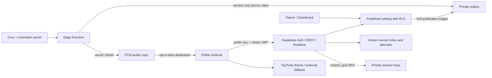

# Architecture and security

CURLYmax has one data path: **Supabase**. The Flutter app contains no sample catalog, local account, local note store, local score calculation or answer keys. Missing client configuration produces a setup screen rather than invented data.

`lib/config.dart` reads public build settings, validates the HTTPS endpoint, and rejects service-role/secret keys. `config/live.json` and Firebase's public client JSON are ignored by Git and source packaging. Privileged notification credentials belong only to the server.

`lib/store.dart` queries the real catalog, restores Supabase Auth sessions, stores viewer notes through the Data API and submits selections through the server grading RPC. Only public catalog metadata and pending navigation destinations are cached in preferences. Catalog pagination avoids silently stopping at the Data API's row limit. Launch, resume, Realtime reconnect, manual refresh and a recovery poll fetch current data. Failed queries preserve an existing cached catalog with a clear status; missing schema has its own setup status.

`lib/main.dart` provides the Material 3 dark UI and navigation. A guest's video/notes/quiz destination is persisted before authentication. After sign-in the catalog is fetched again and the target resolved; deleted/unpublished targets are rejected. Email/password and Google browser OAuth use Supabase Auth. YouTube playback uses the official iframe API through youtube_player_iframe, with a persistent external YouTube fallback. Mutating notes exposes progress and preserves failed drafts while the screen remains open.

`lib/notifications.dart` handles Firebase initialization, explicit opt-in, Android permission, topic subscriptions, foreground notifications and background/cold-start taps. Message targets must be video/quiz UUIDs, not URLs. Listeners are disposed with the app, configuration readiness updates the account screen, and foreground duplicate event IDs are suppressed.

PostgreSQL is the authorization boundary. Guests can read only visible published catalog content; question rows require authentication. Notes and attempts are isolated by `auth.uid()`. Direct attempt writes are revoked; only `submit_quiz` can grade/store scores for the caller. Owner membership lives in a private table, not user-editable metadata. Security-definer functions use an empty search path and qualified object names. Answer keys and notification claims are unavailable to client roles.

Published questions are frozen until their quiz is put back in draft. Historical attempts retain score/total and do not expose raw answers or keys. Unlimited retries can let a determined viewer infer answers from aggregate scores; they do not expose a downloadable answer-key endpoint.

The outbox is unique by `(kind,item_id)` and claims work atomically with `FOR UPDATE SKIP LOCKED`. It sends only while the item is visible and makes one FCM HTTP send attempt per event. Failed/ambiguous events require operator review instead of duplicate-prone blind retries. Delivery itself is subject to FCM/network limitations.

Unit tests inject HTTP responses into the actual Supabase repository. A separate Android integration test uses real Supabase Auth/RLS and server grading against isolated local fixtures. Neither mechanism exists as an application runtime mode.
