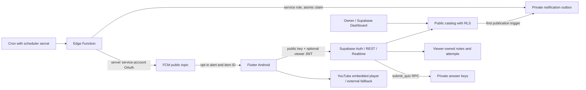

# Architecture and security boundaries

Flutter talks to Supabase using only the public project key and, after login, the viewer JWT. RLS is the authorization boundary. The catalog is public only when its video, channel and section are visible. Quiz metadata is public so guests can discover it; question rows require authentication. Notes are owned by `auth.uid()`. Attempts are created only through `submit_quiz`; direct score writes are revoked.

`lib/store.dart` is the demo/live repository and catalog synchronization layer. Public catalog cache survives network loss; notes and quizzes require a successful backend request in live mode. Launch, Android resume, Realtime subscription/re-subscription, pull-to-refresh and a recovery poll fetch the catalog. Refreshes are serialized with a trailing refresh if another event arrives mid-fetch.

`lib/main.dart` owns routing, Material 3 screens and persistent destinations. A pending destination stores item IDs and target tab before authentication; after login the catalog is fetched again and the published destination is resolved. Deleted/unpublished items produce an unavailable message. Reconnection errors retain the destination for retry. OAuth PKCE is handled by Supabase Flutter. The route survives Android process death via preferences.

`lib/notifications.dart` configures the Android channel, opt-in topic subscription and FCM tap handlers. Foreground messages are displayed with local notifications; the FCM SDK displays notification payloads while backgrounded/terminated. Both resolve through the same destination coordinator. No arbitrary URL from a message is executed: IDs resolve through the published catalog. Notifications do not require a signed-in viewer; quizzes reached through them do.

SQL `SECURITY DEFINER` functions use an empty search path and qualified table references. Answer keys and owners are in a non-exposed schema. `is_owner` reads database membership, not editable user metadata. Publication and notification operations are denied to regular users. Public RPCs expose no answer keys or correctness per question; retries return aggregate scores, as requested. With unlimited retries, aggregate scores can let a determined user infer answers; that is inherent to retryable quizzes, not a key download endpoint.

Published questions cannot be edited until their quiz is put back in draft. Attempt score/total is an immutable historical result; no raw answers or answer keys are retained in viewer rows. All note text is rendered as Flutter text, not executable HTML.

The outbox has a unique `(kind,item_id)` constraint and atomic `FOR UPDATE SKIP LOCKED` claim. Re-publishing never creates a second event. Pending events are dispatched only while the item is visible. Delivery uses one HTTP send attempt per event: a failed/ambiguous call is not blindly retried. This favors avoiding duplicate alerts over guaranteed delivery; FCM and external HTTP cannot provide an exactly-once delivery guarantee. An operator must investigate stranded `dispatching` or `failed` events. Android tags, collapse keys and foreground event-ID deduplication further limit repeat presentation.

No owner login, Supabase service key, Google client secret or FCM server key is part of the app. Public client configuration is supplied at build time. Demo mode explicitly uses local account state, sample videos and local grading; it never pretends to be live authentication or server scoring.
